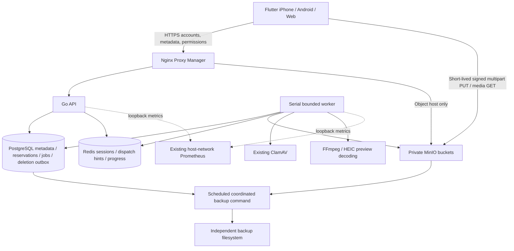

# Architecture

MyCloud is a private family photo/video service, branded **Mynube** in Flutter. Keep the existing Go/Gin API, serial Go worker, PostgreSQL, Redis, MinIO and ClamAV. The numbered root documents are historical design notes; these runbooks describe the current implementation and release gates.

## Data and authorization

Users own media permanently; sharing never changes `owner_id`. Households have owner/admin/member memberships. The migration assigns existing accounts to the original installation's family, preserving existing all-family sharing. New households require creation plus email-bound, expiring, single-use invitation acceptance. Original installation account invitations retain the existing admin-controlled onboarding model. A new bootstrap creates the first private family.

Feed posts belong to an author and one selected family. `post_media` references owned, ready media. Removing a post preserves originals. Household removal ends scoped access and removes that author's posts in that household. Removing an asset hides its feed/album references immediately; permanent deletion cascades references.

Albums remain available. Specific-recipient grants require a shared household. All-family grants now store an explicit `family_id`; existing nil-recipient shares are scoped to the original family. SQL `share_applies_to` and `can_view_media` enforce current membership/expiration. Account administrators manage accounts without implicit private-library, album or post ownership rights. Profiles/directories are scoped to shared families; account admins may view account profile information for administration.

## Upload and processing lifecycle

1. Authenticate against a current active account; validate filename, supported MIME and the 512 MiB maximum.
2. Begin multipart storage upload and atomically reserve quota in PostgreSQL, under the user's row lock. Redis cannot discard reservation state.
3. Issue part URLs for the owner, expected upload ID and permitted part range. Parts normally contain 5 MiB. URLs expire after 15 minutes; upload sessions expire after 48 hours.
4. Complete multipart; inspect actual object size and magic bytes before accepting metadata. Completion retries are idempotent and owner-only.
5. Insert pending metadata and reserve an 8 MiB derivative allowance. Persist processing jobs in PostgreSQL; Redis contains replaceable dispatch hints.
6. The serial worker claims a job atomically, scans through ClamAV, promotes the original, generates bounded previews, records dimensions/duration and SHA-256, and marks ready. Staging remains until success so processing can recover after a crash.
7. Re-dispatch queued work, recover leases after 12 minutes and retry failed work up to three attempts. A job has a ten-minute deadline; each media command has a 90-second deadline. Decode is limited to 100 million pixels, two FFmpeg threads, bounded allocation/output, a private temp directory and local-file protocols. HEIC uses libheif for temporary preview input; originals remain unchanged.
8. Expired sessions abort multipart and remove completed staging before releasing reservations. The pinned MinIO release does not support the S3 AbortIncompleteMultipartUpload lifecycle rule. Its built-in stale multipart sweep covers the crash window before reservation persistence; the application sweeper handles recorded sessions. Neither mechanism expires accepted originals. See the [pinned multipart implementation](https://github.com/minio/minio/blob/RELEASE.2025-09-07T16-13-09Z/cmd/erasure-multipart.go) and [lifecycle compatibility](https://github.com/minio/minio/blob/RELEASE.2025-09-07T16-13-09Z/internal/bucket/lifecycle/rule.go).

## Deletion and quota

Trash lasts 30 days and continues to consume quota. Database deletion atomically retains object keys and charged bytes in `media_deletions`. A sweep retries physical deletion and releases the charge only after acknowledgement. Processing assets wait beyond the worker lease before final acknowledgement, preventing late derivatives from becoming untracked. Exact object versions and deterministic derivative keys are removed on permanent deletion. Independent backup retention still applies.

Ready usage counts original plus actual derivatives. Processing charges include the bounded preview reservation until the result commits. Upload reservations include original plus that allowance and remain held through cleanup failures. Avatars are separately capped at 5 MiB per user. These are logical account quotas; staging copies and historical versions can temporarily consume additional physical space. Monitor actual disk capacity. `reconcile-storage` measures originals/derivatives and repairs accounting during a maintenance window; it never silently deletes unidentified objects or raises quotas.

## Boundaries

Only API and S3 media traffic require public HTTPS. PostgreSQL, Redis, ClamAV and worker stay on `mycloud_mycloud_internal`. API and MinIO also join the existing NPM network. Diagnostics use a separate container port 9090; the monitoring override publishes API/worker diagnostics only at host `127.0.0.1:19090/19091` because this server's Prometheus uses host networking.

See [security.md](security.md), [storage.md](storage.md), [deployment.md](deployment.md), [backup-restore.md](backup-restore.md), and [validation.md](validation.md).
